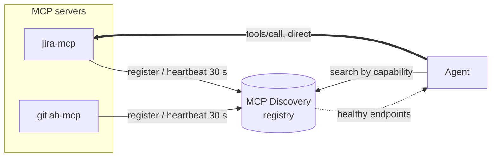
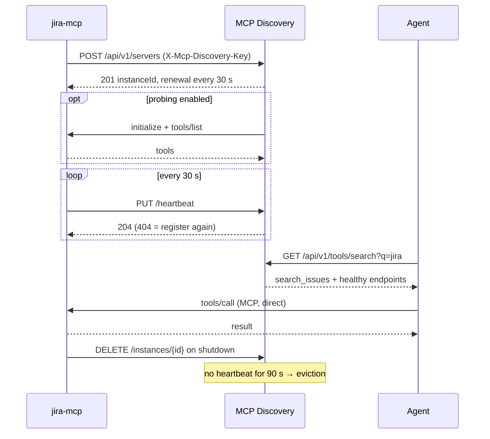

# Architecture

MCP Discovery is a service registry for [Model Context Protocol](https://modelcontextprotocol.io) servers. It tells agents which server can perform a task and where a healthy instance of it runs; agents then call the server directly ([ADR 0001](adr/0001-registry-not-gateway.md)).

## Components

## Lifecycle of an instance

## Modules

| Module | Role |
| --- | --- |
| `mcp-discovery-core` | Registry, leases, self-preservation, tool search, MCP probe — plain Java |
| `mcp-discovery-client` | HTTP client: registration, heartbeats, re-registration, search |
| `mcp-discovery-spring-boot-starter` | Embeds the registry in a Spring Boot app (`@EnableMcpDiscoveryServer`) |
| `mcp-discovery-client-spring-boot-starter` | Registers a Spring Boot MCP server from `application.yml` |
| `mcp-discovery-server` | Ready-to-run registry, shipped as a Docker image |

The reasoning behind each choice is in the [Architecture Decision Records](adr/README.md).
